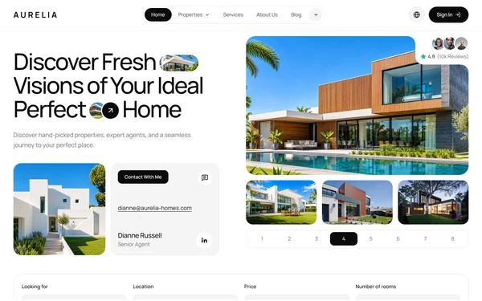
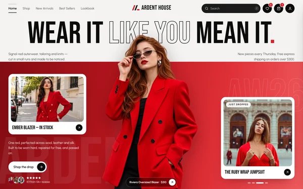
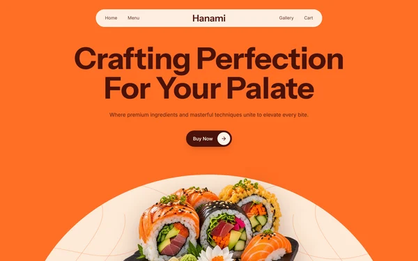
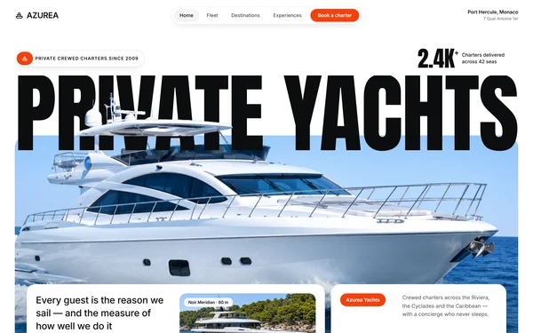
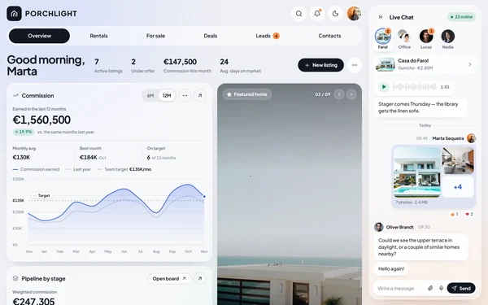
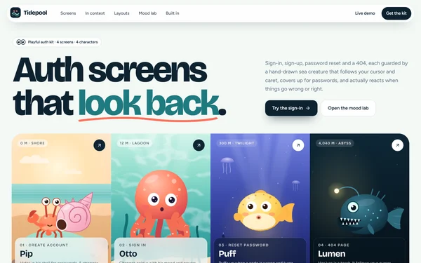

  <a href="https://usetemplates.store">
    <picture>
      <source media="(prefers-color-scheme: dark)" srcset="assets/logo-light.png">
      <source media="(prefers-color-scheme: light)" srcset="assets/logo-dark.png">
      
    </picture>
  </a>

<h1 align="center">usetemplates.store</h1>

  Premium <b>React + Tailwind</b> website, dashboard & app templates, each with a live preview you can click through before you buy.

  <a href="https://usetemplates.store"><b>Browse templates</b></a>
  &nbsp;·&nbsp;
  <a href="https://docs.usetemplates.store">Docs</a>
  &nbsp;·&nbsp;
  <a href="mailto:support@usetemplates.store">support@usetemplates.store</a>

 

<table align="center">
  <tr>
    <td align="center" width="33%">
      
       <b>Hooma</b> · Real-estate website
    </td>
    <td align="center" width="33%">
      
       <b>Ardent House</b> · Fashion store
    </td>
    <td align="center" width="33%">
      
       <b>Hanami</b> · Sushi restaurant
    </td>
  </tr>
  <tr>
    <td align="center" width="33%">
      
       <b>Aqua Charter</b> · Yacht charter
    </td>
    <td align="center" width="33%">
      
       <b>Porchlight</b> · Real-estate CRM dashboard
    </td>
    <td align="center" width="33%">
      
       <b>Tidepool</b> · Auth screens kit
    </td>
  </tr>
</table>

Every template has a live preview at <code>&lt;template&gt;.usetemplates.store</code>. See the full catalogue at <a href="https://usetemplates.store">usetemplates.store</a>.

### From the blog

<!-- BLOG-POST-LIST:START -->- [Best Restaurant Website Templates &lpar;React + Tailwind&rpar; in 2026](https://usetemplates.store/blog/best-restaurant-website-templates-react-tailwind)
- [How to Choose a Website Template for a Small Business](https://usetemplates.store/blog/how-to-choose-a-website-template-for-a-small-business)
- [Deploy a React + Tailwind template to Vercel, Netlify or cPanel](https://usetemplates.store/blog/deploy-react-tailwind-template-vercel-netlify-cpanel)
- [Best SaaS Dashboard Templates for React &lpar;2026&rpar;](https://usetemplates.store/blog/best-saas-dashboard-templates-react)
- [Accepting Mobile Money on a Website in Tanzania](https://usetemplates.store/blog/accept-mobile-money-website-tanzania)
<!-- BLOG-POST-LIST:END -->

Guides, tutorials and template showcases. Read them all at <a href="https://usetemplates.store/blog">usetemplates.store/blog</a>.

### How buyer access works

1. **Pick a template** at [usetemplates.store](https://usetemplates.store) and try its live preview.
2. **Buy it** and add your GitHub username (or sign in with GitHub) so we know where to send access.
3. **Accept the invite.** You're added with read access to that template's **private repository** in this organization (private repos don't show in the public list here). You get the full source, and updates arrive with `git pull`.
4. **Build.** Clone, `npm install`, `npm run dev`. Setup guides live at [docs.usetemplates.store](https://docs.usetemplates.store).

Use is covered by the [licence terms](https://usetemplates.store/licence). Questions or a missing invite? Email [support@usetemplates.store](mailto:support@usetemplates.store).

Made in Zanzibar by <a href="https://github.com/yusosadick">Yuso Sadick</a> · <a href="https://yusouf.dev">yusouf.dev</a>

